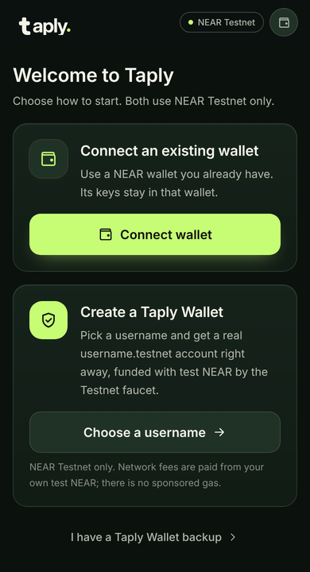
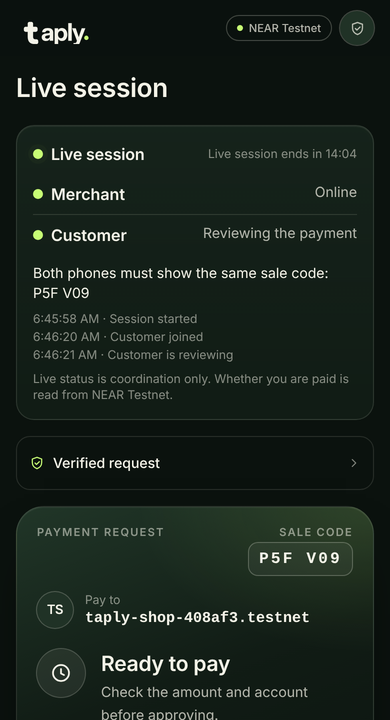
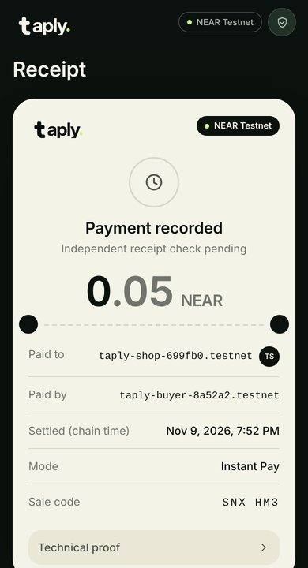

<p align="center"></p>
<h3 align="center">A wallet that turns a payment into a shared, verifiable receipt.</h3>
<p align="center">
  <a href="https://taplyapp.xyz">Try Testnet</a> ·
  <a href="https://taply-mainnet-git-staging-mainnet-kendinecryptos-projects.vercel.app/m">Mainnet Preview</a> ·
  <a href="docs/JUDGE_QUICK_START.md">Judge quick start</a> ·
  <a href="docs/RELEASE_STATUS.md">Release & evidence</a>
</p>
<p align="center">
  <a href="https://github.com/KendineCrypto/taply/actions/workflows/workspace-check.yml"></a>
  <a href="https://github.com/KendineCrypto/taply/actions/runs/43650817911"></a>
  <a href="LICENSE"></a>
</p>

Taply is a mobile-first NEAR wallet and payments app for shops, freelancers and
people sharing a bill. Create an on-chain request, share a QR or link, review the
exact amount, and approve in your wallet. Both sides can check what actually
happened on chain.

**The product promise:** sending a transaction, receiving funds and independently
verifying a receipt are different states. Taply makes that difference visible.

## Start here

| You want to… | Open |
| --- | --- |
| Understand and evaluate Taply in five minutes | [Judge quick start](docs/JUDGE_QUICK_START.md) |
| Try the wallet and payments without real money | [taplyapp.xyz — NEAR Testnet](https://taplyapp.xyz) |
| Inspect a real 0.1 NEAR Mainnet settlement without signing | [Public proof and replay instructions](docs/evidence/mainnet-live-settlement-2026-11-14/README.md) |
| Match source, tests and deployed behavior | [Release status](docs/RELEASE_STATUS.md) |
| Trace the trust boundaries and source files | [System overview](docs/SYSTEM_OVERVIEW.md) |

**Release snapshot — 14 November 2026 UTC:** `main` contains the Testnet release.
The separate Mainnet source is on `staging/mainnet`, validated at
[`f88bc3f`](https://github.com/KendineCrypto/taply/tree/f88bc3fdd1d7b9cfabf95f73a3b48baf376968eb).
A real Mainnet payment has been independently verified. The latest receipt/UX
fixes are merged there but **are not yet live**: Vercel rejected their deployment
with `build-rate-limit`. The Preview link can therefore show older behavior.
The Testnet domain has not been switched to Mainnet. [Exact status and CI](docs/RELEASE_STATUS.md).

## The payment experience

<table>
<tr>
<td align="center"><br><sub>Create or connect a wallet</sub></td>
<td align="center"><br><sub>Scan the sale, review together</sub></td>
<td align="center"><br><sub>Check the result on chain</sub></td>
</tr>
</table>

*Screenshots: real Testnet browser runs, 9–10 November. They are not Mainnet deployment evidence.*

1. **Create:** the recipient creates an immutable on-chain request with amount,
   asset and expiry. The link identifies the request; the payer reads its terms.
2. **Review:** the wallet shows the recipient, exact amount and transaction before
   the user approves. A Testnet Live Handshake adds shared presence and a sale code.
3. **Settle:** NEAR executes the call and asynchronous payout. Session messages,
   wallet returns and timers cannot establish payment success.
4. **Verify:** a receipt distinguishes the contract's recorded result from an
   independent check of funding, payout and callback receipts.

## What is built

| Capability | Testnet evidence | Mainnet scope |
| --- | --- | --- |
| **Taply Wallet** — create/restore, encrypted local vault, send/receive, QR | [Real browser onboarding and restore](docs/evidence/production-2026-11-09-onboarding/phrase-result.json) | Separate Mainnet vault and wallet protocol; [browser CI](https://github.com/KendineCrypto/taply/actions/runs/43650817835) |
| **Request → QR → pay → receipt** | [Production browser regression](docs/evidence/production-regression-2026-11-11/) | [Real 0.1 NEAR settlement, independently verified](docs/evidence/mainnet-live-settlement-2026-11-14/README.md) |
| **Both devices follow the payment** | [Cashier automatic verification](docs/evidence/cashier-auto-verify-2026-11-12/result.json) | Automatic QR-to-receipt and first-attempt native verification merged in [PR #38](https://github.com/KendineCrypto/taply/pull/38); deployment pending |
| **Protected Pay** — explicit lock, refund before cutoff, release afterwards | [Real refund/release](docs/evidence/production-protected-pay-2026-11-11/result.json) · [14 adversarial refusals](docs/evidence/protected-adversarial-2026-11-11/result.json) | Separate contract/integration; a Mainnet refund/release is not established by the native-payment proof |
| **Gift** — personal transfer or claimable Open Gift | [Design and sandbox evidence](https://github.com/KendineCrypto/taply/blob/f88bc3fdd1d7b9cfabf95f73a3b48baf376968eb/docs/GIFT.md) | Owner reports successful funding/claim; compact claim/result UI passes CI. No independent Gift transaction proof is archived in this snapshot |
| **Other assets** | [Real Testnet USDC](docs/evidence/testnet-e2e/2026-11-09T17-43-37-563Z-usdc-pay.json), converted to NEAR before payment | USDC and 1Click integration have scoped tests; not claimed as a live cross-chain settlement |
| **Merchant tools, contacts, Split, Recurring** | [Feature-by-feature matrix](docs/VERIFICATION_MATRIX.md) | Mainnet product browser checks; templates do not debit automatically |

English and Turkish, a mobile-first PWA, explicit transaction confirmations and
reduced-motion support are part of the app. Social login and sponsored gas are
not implemented. Testnet evidence is never relabelled as Mainnet evidence.

## Why NEAR matters here

NEAR's asynchronous execution makes a wallet's “submitted” result insufficient
for a merchant. Taply follows the actual promise/receipt graph and callback
before calling a payout complete. The verifier binds that graph to the exact
request, beneficiary, asset, amount and pinned contract.

Named Testnet accounts make onboarding readable; NEP-141 supports token payment
flows. The wallet uses a standard BIP-39 phrase and NEAR derivation path
`m/44'/397'/0'`. No server holds a user's recovery phrase or signing key.

[Architecture and source map](docs/SYSTEM_OVERVIEW.md) ·
[Payment state machine](docs/PAYMENT_STATE_MACHINE.md) ·
[Security model](docs/SECURITY.md)

## Evidence you can inspect

| Evidence | Result | Scope |
| --- | --- | --- |
| [Mainnet verifier output](docs/evidence/mainnet-live-settlement-2026-11-14/proof.json) | `VERIFIED_SETTLEMENT`, `PAID`, exact **0.1 NEAR** | Live Mainnet, read-only observation; configured-RPC trust |
| [Mainnet workspace CI](https://github.com/KendineCrypto/taply/actions/runs/43650817911) | Shared **93**, near-client **347**, web **1,598 passed / 7 skipped**, API **85**; browser phases and builds passed | Tested source `d984206`; source-equivalent squash `f88bc3f` |
| [Mainnet contract CI](https://github.com/KendineCrypto/taply/actions/runs/43650817864) | Rust checks, candidate WASM and real local NEAR sandbox passed | Synthetic/local chain; not a real-funds payment or an audit |
| [Wallet browser CI](https://github.com/KendineCrypto/taply/actions/runs/43650817835) | Desktop/mobile-emulation crypto compatibility passed | Browser compatibility, not physical-device certification |
| [Testnet proof ledger](docs/EVIDENCE.md) | Public accounts, transaction hashes and receipt observations | Real Testnet with original dates preserved |

The Mainnet browser workflow includes **68/68** Phase 4, **31/31** Phase 5,
**18/18** Phase 6 and **6/6** authority integration checks. It tests lost
responses, unknown outcomes and replay refusal, not just the happy path.
Counts are a snapshot of that commit, not a coverage percentage or audit claim.

## Run locally

Node **24.22.2**, pnpm **11.5.0**. Start with the Testnet branch:

```sh
git clone https://github.com/KendineCrypto/taply.git
cd taply
git switch main
pnpm install --frozen-lockfile
pnpm check
cp apps/web/env/public-readonly.env.example apps/web/.env.local
pnpm --filter @taply/web build
pnpm --filter @taply/web start
```

Open `http://localhost:3000`. This configuration is read-only. For Testnet
signing, enable `NEXT_PUBLIC_TAPLY_FLAG_INSTANT_PAY=on` in the local env and
rebuild. Live Handshake also needs Redis: [setup](docs/JUDGE_QUICK_START.md#reproduce-locally).
Standalone API tests: `node --test apps/api/test/*.test.mts`.

For Mainnet source and a **read-only** replay of the recorded payment, use the
[pinned verification instructions](docs/evidence/mainnet-live-settlement-2026-11-14/README.md#reproduce-the-check).
That check needs no wallet, signature or funds.

## Boundaries worth knowing

- **Not audited.** Mainnet uses real funds; successful transactions and green CI
  do not establish general safety. The contracts and browser wallet have no
  independent external security audit.
- **RPC trust is explicit.** Receipt verification uses configured RPCs, not a
  light client. Busy/pruned RPCs can leave verification unavailable.
- **Unknown stays unknown.** A retained transaction hash can retire a pending
  attempt only after matching FINAL execution proof. Missing evidence never
  triggers a resend; completed operation IDs remain non-replayable.
- **Device ledger scope.** Mainnet's release ledger coordinates tabs on one
  device. It is not an account-wide direct-send deduplication service across
  devices. On-chain requests enforce their own single-payment rules.
- **Asynchronous callback uncertainty remains a real boundary.** A successful
  transfer with a missing callback must not become a second payout. The dated
  Testnet R-2 analysis is preserved in [R2_REACHABILITY.md](docs/R2_REACHABILITY.md).
- **Feature evidence has limits.** Contacts/templates are local; Recurring does
  not autocharge. Testnet swaps use test tokens and separate approvals. The
  archived native Mainnet proof establishes no USDC, Gift or cross-chain result.

## Repository and provenance

| Path | Responsibility |
| --- | --- |
| `apps/web` | Wallet, request/QR, payment and receipt UI; in-app server routes |
| `apps/api` | Standalone session-service implementation and integration tests |
| `packages/shared` | Schemas, canonical hashing and payment protocol types |
| `packages/near-client` | Chain reads/builders, wallet protocol and receipt verification |
| `contracts/payments*`, `contracts/gift*` | Network-specific payment and Gift contracts/candidates; see the source map |
| `docs/evidence` | Dated public evidence and reproducible runs |
| `brand` | Taply identity and original project assets |

Built for the **NEAR Hackathon · Real-World Money** track, under human product
and release direction. Claude Code contributed the web experience, wallet,
integrations and release work; Codex contributed contracts, backend/shared
protocol work, verification and review. AI assistance is disclosed; test output
and public chain evidence remain the basis for claims.

Development history: [Testnet commits](https://github.com/KendineCrypto/taply/commits/main)
and [Mainnet commits](https://github.com/KendineCrypto/taply/commits/staging/mainnet).
The Testnet history and Mainnet staging history are separate review targets;
[release status](docs/RELEASE_STATUS.md) records both. Historical reports keep
their original dates. [Third-party notices](THIRD_PARTY_NOTICES.md).

Code: [MIT](LICENSE), © 2026 KendineCrypto_. Brand assets: [NOTICE](NOTICE).
