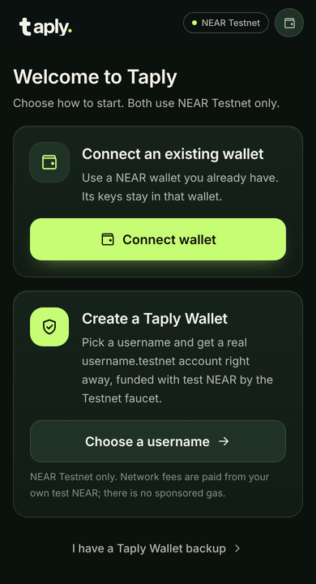
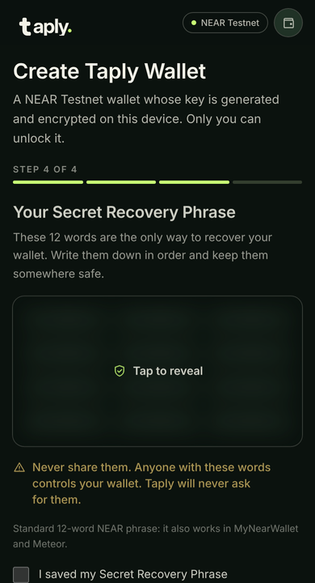
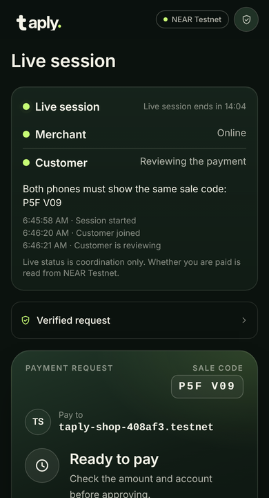
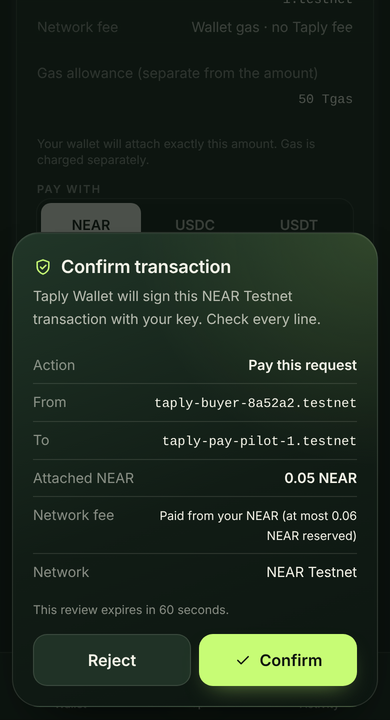
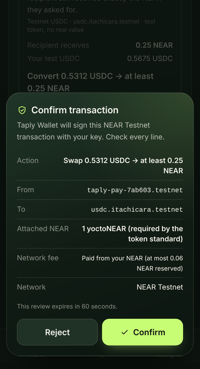
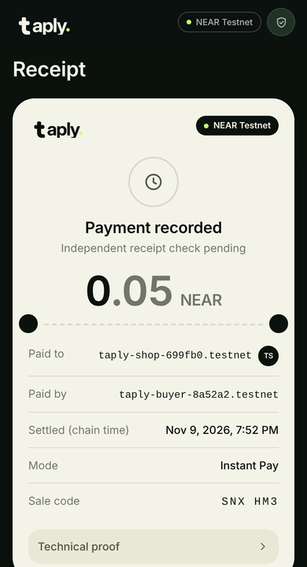

<p align="center">
  
</p>

<h3 align="center">Your wallet. Your payment. One tap.</h3>

<p align="center">
  Merchant payments on NEAR that both phones can check on chain by themselves.<br>
  <strong><a href="https://taplyapp.xyz">taplyapp.xyz</a></strong> · NEAR <strong>Testnet only</strong> · no real funds · MIT
</p>

<p align="center">
  <a href="#try-it-in-5-minutes">Try it</a> ·
  <a href="#features">Features</a> ·
  <a href="#how-it-works">How it works</a> ·
  <a href="#evidence">Evidence</a> ·
  <a href="#run-it-locally">Run locally</a> ·
  <a href="#limitations">Limitations</a>
</p>

---

Taply is a mobile-first web app (PWA) that turns a NEAR Testnet wallet into a
point of sale. The merchant creates one on-chain request per sale. The customer
scans the QR, sees the exact amount and receiving account **read from the
contract**, approves in their own wallet, and may pay with NEAR or with another
Testnet asset that is converted to NEAR first. Both phones then verify the
receipt on chain. Nothing says "paid" until the chain does.

<table>
  <tr>
    <td align="center"><br><sub>Start in seconds</sub></td>
    <td align="center"><br><sub>Real <code>name.testnet</code> + 12 words</sub></td>
    <td align="center"><br><sub>Live two-phone session</sub></td>
  </tr>
  <tr>
    <td align="center"><br><sub>See exactly what you sign</sub></td>
    <td align="center"><br><sub>Pay a NEAR request with USDC</sub></td>
    <td align="center"><br><sub>Receipt from the chain</sub></td>
  </tr>
</table>

<sub>All screenshots are from real NEAR Testnet runs on taplyapp.xyz (2026-11-09/10) with disposable test accounts.</sub>

## Why

Paying a shop in crypto usually means copying an address, trusting a
screenshot as a receipt and hoping the merchant's screen means what it says.
At a counter, three things are still missing:

- the customer cannot easily confirm that **this** QR is **this** sale, for **this** amount, to **this** account;
- the merchant cannot tell "a transaction was sent" from "I was paid";
- a receipt is a claim made by an app, not something either side can check.

Taply fixes all three with public NEAR data: one immutable request per sale, a
QR that carries only the request ID, and a receipt verifier that runs on both
phones. We do not claim to have invented QR payments, payment links or escrow.

## Try it in 5 minutes

No wallet or funds of your own are needed: the app creates a NEAR Testnet
account with free test NEAR from the public faucet.

| | Do | You should see |
| --- | --- | --- |
| 1 | Open **[taplyapp.xyz](https://taplyapp.xyz)** on a phone (or a ~390 px browser window) | **Welcome to Taply**: connect an existing wallet, or create a Taply Wallet |
| 2 | **Choose a username** → pick a name → set a password (8+ characters) | Your 12-word Secret Recovery Phrase (hidden until tapped), then "*name*.testnet is live on NEAR Testnet" with 10 test NEAR |
| 3 | Tap **Request**, enter `0.05`, create it | Taply's **Confirm transaction** dialog, then the request page with a QR, a sale code and a **Live session** card |
| 4 | Open the payment link in a second browser (or a private window) and create another wallet there | Both screens show each other **online** and the **same sale code**; the merchant sees "Reviewing the payment" |
| 5 | Pay in NEAR — or pick **USDC** (or USDT, NST, LNC, PEM) under *Pay with* | Each step has its own confirmation. Both phones switch to **Payment recorded** from the chain; the merchant receives exactly the NEAR requested and the balance updates |
| 6 | Open **[the 2026-11-01 pilot receipt](https://taplyapp.xyz/receipt/9b9a572416f7480cddb3f8936ef2f3c77196c4157c5cb35e2830e1769b7c4502?ftx=CrzQ57JxC6ZtGWBYcYFq5Y92J3V6dgf2jKC64AnyQ9Su)** | The independent verifier re-checks the funding, transfer and callback receipts, code hash and access keys: **Verified Paid** |

Also worth a look: [taplyapp.xyz/demo](https://taplyapp.xyz/demo) (the whole
journey with synthetic data, stamped **DEMO**) and **Settings → Türkçe** (the
full app in Turkish). More detail: [docs/JUDGE_QUICK_START.md](docs/JUDGE_QUICK_START.md).

## Features

Everything below is live on taplyapp.xyz and was proven with real NEAR Testnet
transactions in a real browser.

| Feature | What it does | Proof |
| --- | --- | --- |
| **One-tap onboarding** | Connect an external NEAR wallet (NEAR Connect: Meteor, HERE, MyNearWallet…) **or** pick a username and get a real `username.testnet` account, created by the faucet and confirmed by a final chain read | [run](docs/evidence/production-2026-11-09-onboarding/phrase-result.json) |
| **Taply Wallet** | Built-in wallet: standard 12-word phrase (BIP-39, NEAR path `m/44'/397'/0'`, also opens in MyNearWallet / Meteor), encrypted on the device, restore from phrase, send / receive / QR. Enter the password once; it stays unlocked on that device until **Lock now** (max 30 days) | [stays unlocked](docs/evidence/taply-wallet-stay-unlocked-2026-11-10/stay-unlocked-result.json) |
| **See what you sign** | Every Taply Wallet transaction opens a dialog with the exact action, accounts, attached NEAR and fee. Reject = nothing sent | [screens](docs/evidence/production-taply-wallet-2026-11-09/) |
| **On-chain request per sale** | The merchant signs one immutable request (recipient, exact yoctoNEAR amount, expiry). The QR holds only its ID; the payer's phone reads the terms from the contract | [create + pay run](docs/evidence/production-taply-wallet-2026-11-09/create-request-result.json) |
| **Pay with any supported asset** | The merchant always asks for NEAR. The payer may use NEAR, USDC, USDT, NST, LNC or PEM; the token is swapped to NEAR on Ref/Rhea Testnet first (curated pools, quote at a final block, 0.5 % buffer, 5 % price-impact cap) | [USDC](docs/evidence/testnet-e2e/2026-11-09T17-43-37-563Z-usdc-pay.json) · [USDT](docs/evidence/testnet-e2e/2026-11-09T18-19-47-447Z-usdt-pay.json) · [in browser](docs/evidence/production-taply-wallet-2026-11-09/result.json) |
| **Live Handshake** | The merchant's QR opens a live two-phone session: online / reviewing / paying, disconnect and reconnect, same sale code, countdown to expiry. The QR is drawn once and never changes; any camera or Taply's own scanner opens it. A second phone with the same QR is refused. Payment status is never taken from the session | [production run](docs/evidence/production-live-handshake-2026-11-10/result.json) · [QR + scanner](docs/evidence/qr-stable-2026-11-10/result.json) |
| **Honest states** | Ready → Payment observed → **Paid per contract** → **Verified Paid**. Wallet returns, server events and timers never mark anything paid | [state machine](docs/PAYMENT_STATE_MACHINE.md) |
| **Independent receipt verifier** | Each phone checks the funding, transfer and callback receipts, the contract code hash and access keys. Falls back to a clearly labelled archived record if public RPCs are busy | [ledger](docs/EVIDENCE.md) |
| **Live balance** | The Taply Wallet balance refreshes after every signature, every 20 s and when the app comes back to the foreground | [production run](docs/evidence/production-balance-2026-11-10/balance-refresh-result.json) |
| **Merchant tools** | Register and store QR (`/merchant`, `/checkout/<account>`), QR scanner, contacts (on device), Split Pay and Recurring templates (they pre-fill normal requests; nothing runs automatically) | live site |
| **English / Türkçe, PWA, accessible** | Mobile first (360–430 px), keyboard and screen-reader friendly, reduced motion | live site |

**Off on purpose:** Protected Pay (escrow), contract-bound merchant sessions,
merchant sale signing, social login and sponsored gas. Network fees are paid
from the user's own test NEAR.

## How it works

```text
 Merchant phone                     NEAR Testnet                        Customer phone
 ──────────────                     ────────────                        ──────────────
 create request ──── signs ────▶  taply-pay-pilot-1.testnet
 show QR (request ID only)                │                     ◀── reads terms at a final block
                                          │                          (optional) swap token → NEAR
                                          │                              on ref-finance-101.testnet
                                          │  ◀──── pay_instant_native ── approves in own wallet
 reads status + verifies receipts ◀───────┴───────▶ reads status + verifies receipts

        Live Handshake room (Upstash Redis): presence and events only — never "paid"
```

- **The chain is the only payment authority.** Every read is anchored to a
  finalized block on NEAR Testnet (genesis hash checked). The app checks the
  contract's code hash at a fresh final block before any signature.
- **Contract:** [`taply-pay-pilot-1.testnet`](https://testnet.nearblocks.io/address/taply-pay-pilot-1.testnet),
  approved code hash `BrR6bioUxuLzYD9m3TMSXmY9KYiLSrq3DSnQrfP6iZ9B`. The payer
  sends exactly the requested amount; the contract pays the merchant out and
  records `FINAL_PAID` only after the payout succeeds.
- **Taply Wallet** keeps the key in the browser: only the phrase's entropy is
  stored, encrypted with AES-GCM under a PBKDF2 (600k) password key. The
  "stay unlocked" session is a non-extractable browser key in IndexedDB.
  Before signing, the wallet backend checks that the transaction has exactly
  the expected shape (receiver, method, amount, gas).
- **Other assets:** NEAR Intents has no Testnet, so swaps use Ref/Rhea Testnet
  pools (`wrap.testnet`, curated routes). Convert and pay are two separate,
  clearly labelled approvals.
- **Live Handshake** rooms live in Upstash Redis with hashed tokens, a one-time
  join claim, a single atomic sync per 2 s poll, and expiry tied to the
  request's deadline (max 2 h). The join secret is removed from the URL right
  after joining.
- **A wallet result that is unclear blocks a repeat payment** until the chain
  explains it, so nobody pays twice by accident.

Deeper reading: [architecture](docs/ARCHITECTURE.md) ·
[payment state machine](docs/PAYMENT_STATE_MACHINE.md) ·
[security](docs/SECURITY.md) · [API](docs/API.md) · [UX flows](docs/UX_FLOWS.md) ·
[protocol freeze v1](docs/LEAD_PROTOCOL_FREEZE_v1.md) ·
[Taply Wallet design](apps/web/src/lib/wallet/TAPLY_WALLET.md).

## Built on NEAR

- **Named accounts** — users get a readable `username.testnet` instead of a hex address.
- **Function-call receipts and promises** — the payout callback is what makes a sale `FINAL_PAID`, and the verifier checks those receipts.
- **Finality and cheap reads** — both phones read terms and status from a final block, every couple of seconds.
- **Access keys** — the verifier refuses a receipt if the contract's keys changed during the payment window.
- **NEP-141 tokens + Ref/Rhea** — any curated Testnet token can pay a NEAR request.
- **Standard key derivation** — the 12-word phrase uses NEAR's `m/44'/397'/0'` path, so it works in other NEAR wallets.

## Evidence

| What | Where |
| --- | --- |
| Ledger of every Testnet proof (hashes, blocks, reproduction commands) | [docs/EVIDENCE.md](docs/EVIDENCE.md) |
| First real payment, 0.1 NEAR, 2026-11-01, Verified Paid | [verifier output](docs/evidence/instant-pay-2026-11-01-receipt.json) · funding tx [`CrzQ57Jx…`](https://testnet.nearblocks.io/txns/CrzQ57JxC6ZtGWBYcYFq5Y92J3V6dgf2jKC64AnyQ9Su) |
| Onboarding on production (username wallet + 12 words, phrase import) | [docs/evidence/production-2026-11-09-onboarding](docs/evidence/production-2026-11-09-onboarding/) |
| Taply Wallet pays in NEAR and with USDC; creates a request another wallet pays | [docs/evidence/production-taply-wallet-2026-11-09](docs/evidence/production-taply-wallet-2026-11-09/) |
| Live Handshake, two browsers, on production | [docs/evidence/production-live-handshake-2026-11-10](docs/evidence/production-live-handshake-2026-11-10/) |
| Stay unlocked across reloads; balance refresh after paying | [stay unlocked](docs/evidence/taply-wallet-stay-unlocked-2026-11-10/) · [balance on production](docs/evidence/production-balance-2026-11-10/) |
| Re-runnable browser scripts (create disposable accounts) | [`taply-wallet-signing-2026-11-09/`](docs/evidence/taply-wallet-signing-2026-11-09/) · [`handshake-e2e.mjs`](docs/evidence/live-handshake-2026-11-10/handshake-e2e.mjs) |
| Session log of every increment | [docs/AUTONOMOUS_PROGRESS.md](docs/AUTONOMOUS_PROGRESS.md) |

All runs reached `FINAL_PAID` with the exact payout. Evidence accounts are
disposable automation accounts from the public faucet.

## Run it locally

Requirements: Node **24.22.2** (see `.node-version`) and pnpm **11.5.0**.

```sh
git clone https://github.com/KendineCrypto/taply.git
cd taply
pnpm install --frozen-lockfile
pnpm check                      # brand, build, types, lint and every workspace test (no funds needed)

cp apps/web/env/public-readonly.env.example apps/web/.env.local
# to sign payments like taplyapp.xyz, set NEXT_PUBLIC_TAPLY_FLAG_INSTANT_PAY=on in .env.local
pnpm --filter @taply/web build && pnpm --filter @taply/web start   # http://localhost:3000
```

Current results of `pnpm check`: shared **93**, near-client **244**, web
**1,204** tests passed (1 skipped). The standalone API tests run with
`node --test apps/api/test/*.test.mts`; contract checks (Rust / WASM / sandbox)
run in the `instant-pay-sandbox` workflow.

<details>
<summary><strong>Live Handshake locally</strong></summary>

```sh
redis-server --port 6390
node apps/web/scripts/redis-rest-shim.mjs 6390 8079 <token>     # Upstash REST protocol on a real Redis
NEXT_PUBLIC_TAPLY_FLAG_HANDSHAKE=on \
KV_REST_API_URL=http://127.0.0.1:8079 KV_REST_API_TOKEN=<token> \
  pnpm --filter @taply/web dev
```

In production the same `KV_REST_API_*` variables come from Vercel → Storage →
Upstash Redis. Without them the app simply hides the live session.
</details>

<details>
<summary><strong>Real Testnet scripts</strong></summary>

```sh
# Two-browser Live Handshake + payment
node docs/evidence/live-handshake-2026-11-10/handshake-e2e.mjs <baseUrl> <outDir> <playwright index.mjs> packages/near-client/testnet-e2e/lib.mjs
# Taply Wallet pays in NEAR and with USDC in a real browser
node docs/evidence/taply-wallet-signing-2026-11-09/taply-wallet-pay-e2e.mjs <baseUrl> <outDir> <playwright index.mjs> packages/near-client/testnet-e2e/lib.mjs
# Other-asset payment without a browser
node packages/near-client/testnet-e2e/token-pay.mjs USDT
# Read-only contract check
node apps/web/scripts/deploy-preflight.mjs post taply-pay-pilot-1.testnet --rpc https://test.rpc.fastnear.com
```

Public Testnet RPCs rate-limit per IP (`HTTP 429`). Taply then says the RPC is
busy and signs nothing. Never pay again to make a demo succeed.
</details>

## Repository layout

```text
apps/web/                     Next.js 16 PWA (TypeScript strict): wallet, POS, pay, receipt, verifier, Live Handshake
apps/api/                     Session/room service prototype (in-process Fetch handlers)
contracts/payments/           Instant Pay contract deployed as taply-pay-pilot-1.testnet
contracts/payments-merchant/  Unreviewed merchant-session candidate (not deployed to the app)
packages/near-client/         Typed NEAR reads and call builders, Taply Wallet vault and signer, Ref/Rhea swap routes
packages/shared/              Protocol schemas, canonical hashing, sale/comparison codes
docs/                         Product, protocol, security, evidence and release reports
brand/                        Logo and brand guidelines
```

## Readiness

| Gate | Meaning ([MILESTONES.md](docs/MILESTONES.md)) | State |
| --- | --- | --- |
| G1 | Real NEAR request → signed settlement → verified `FINAL_PAID` | **Met on Testnet**, live on taplyapp.xyz |
| G2 | Merchant QR checkout + live two-device Handshake | **Mostly met**: live two-phone session on production; binding the session inside the contract is still a candidate |
| G3 | Protected escrow with real refund and release | Candidate proven on Testnet; **off** in the app |
| G4 | Chain-proof receipts + adversarial and UX robustness | Software evidence; no external audit |

The repository also holds isolated, **unreviewed** contract candidates
(Protected Pay escrow, NEP-141 token payments, contract-bound merchant
sessions), each proven with real Testnet transactions
([index](docs/RELEASE_EVIDENCE_INDEX.md), [AI review, not an audit](docs/SECURITY_REVIEW_2026-11-09.md)).
They stay off on the public site until a human security review.

## Limitations

- **NEAR Testnet only, not audited.** Configured-RPC trust model (not a light
  client). The pilot contract keeps a full-access key; the verifier refuses a
  receipt if the contract's keys changed during the payment window.
- **Taply Wallet has not had an independent security review.** Signing was
  turned on for Testnet by the owner's decision. The key lives in the browser.
  While it stays unlocked (up to 30 days, until **Lock now**), anyone holding
  the unlocked device, or a malicious script on the page, could ask it to sign;
  every transaction still shows the confirmation dialog. Test funds only.
- **Other-asset payments use Testnet pools and test tokens** with no real
  value. Convert and pay are two approvals and not atomic: if the payer stops
  after converting, they simply keep the NEAR.
- **External wallets:** a declined signature cannot be proven to have sent
  nothing, so the same payer can retry that request only after the chain shows
  it funded, cancelled or expired (default 15 minutes). Taply Wallet's
  **Reject** is reported as nothing sent.
- **Live Handshake is coordination only.** The sale code identifies the sale;
  it is not merchant authentication. Merchants are shown by account ID.
- **History, contacts and templates are stored on the device**; there is no
  indexer. The site sends `noindex` on purpose. Android has not been tested on
  a physical device.

## How it was built

- **AI coding agents, human direction.** Most code and docs were written by AI
  agents: **Claude Code** (Anthropic) for the web app, Taply Wallet, swaps,
  Live Handshake, releases and documentation; **Codex** (OpenAI) for the
  contract, backend and shared packages. The human owner makes every product
  and release decision. Testnet runs use disposable faucet accounts; the
  owner's wallets were never used by an agent. Disclosed per HACKATHON.md Q-005.
- **No template or earlier app.** The first commit is `db10264` (2026-10-29),
  inside the eligible window.
- **Main dependencies** (exact versions in `pnpm-lock.yaml` and
  `contracts/payments/Cargo.lock`): `next`, `react`, `@hot-labs/near-connect`,
  `jsqr`, `zod`, `near-api-js`, `lossless-json`, `jsonc-parser`,
  `canonicalize`, `@noble/hashes`, `near-sdk` 5.30.0, `borsh`. The BIP-39
  English wordlist is embedded as public data and checked against its standard
  SHA-256. Tooling: TypeScript, Tailwind CSS, Vitest, Testing Library, ESLint,
  Playwright (installed separately for browser runs). Hosting: Vercel, Upstash
  Redis. See [THIRD_PARTY_NOTICES.md](THIRD_PARTY_NOTICES.md).
- **Brand assets** in `brand/` were made for this project.

## Hackathon

- **NEAR HACKATHON**, track **Real-World Money** (`realworld`). Submission
  closes **2026-11-14 23:59 UTC**. Testnet projects are eligible (Q-010).
- **Hackathon diff (Q-003):** every commit was written inside the eligible
  window, so there is no pre-hackathon baseline. Full history:
  [commits on main](https://github.com/KendineCrypto/taply/commits/main).
- The judged source is `main`, identical to `release/taplyapp`, which serves
  taplyapp.xyz.
- Submission package (X post draft, form text, checklist):
  [docs/HACKATHON_SUBMISSION_PACKAGE.md](docs/HACKATHON_SUBMISSION_PACKAGE.md).

## License

Code: [MIT](LICENSE), © 2026 KendineCrypto_. The Taply name and brand assets
are excluded and all rights reserved; see [NOTICE](NOTICE).
