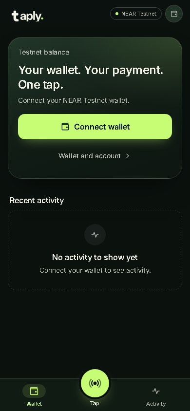
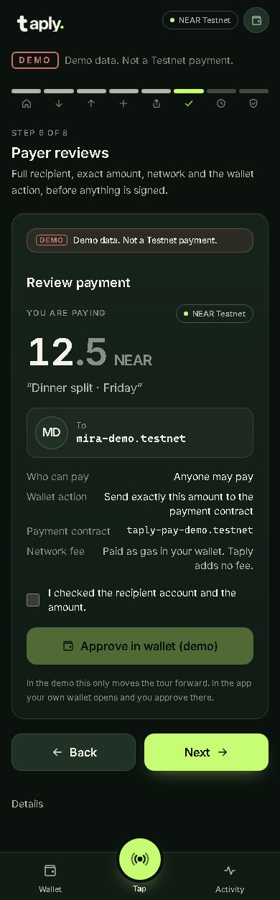
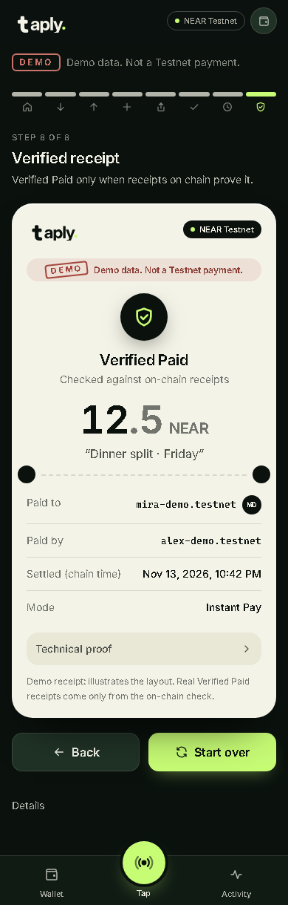
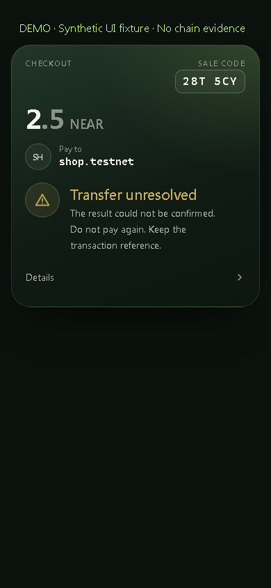

# taply. — merchant payments on NEAR you can check yourself

> **Your wallet. Your payment. One tap.**
> NEAR **Testnet only**. No mainnet, no real funds, no bridges.

Taply is a mobile-first web app (PWA) that turns a NEAR Testnet wallet into a
point of sale. A merchant creates one unique sale; the customer scans its QR,
sees the exact amount and receiving account read from the chain, approves in
their own wallet, and both phones check the receipt on chain by themselves.

**Status on 2026-11-06 (Phase 7I, conditional G1 Testnet release candidate):** Instant Pay is deployed
and verified on NEAR Testnet (contract `taply-pay-pilot-1.testnet`). A real
Instant Pay payment reached `FINAL_PAID` and **Verified Paid** in Taply's
independent receipt verifier ([evidence](docs/EVIDENCE.md)). **Physical iPhone acceptance is outstanding. Normal G1 and isolated G2 candidate Rust/WASM/sandbox CI passed; G2 deployment is NOT authorized. Real G2 Handshake is NO-GO; Protected Pay is disabled.**
Phase 7I simplifies EN/TR copy and disclosures without changing payment logic.
The final integration review's HIGH wallet-retry finding (F-01) is fixed on the
final branch: any wallet error after signing starts, including "declined", now
blocks a repeat payment until the chain explains the first attempt. That fix
awaits independent review ([details](docs/FINAL_INTEGRATION_REVIEW.md#f-01--high--fixed-locally-pending-independent-review-ambiguous-wallet-transport-errors-become-nonblocking-user-rejection)).
Current [release readiness and exact checks](docs/RELEASE_READINESS.md),
[no-wallet judge guide](docs/JUDGE_QUICK_START.md), and
[submission checklist](docs/SUBMISSION_CHECKLIST.md).

Normal CI: [run 42229980978](https://github.com/KendineCrypto/taply/actions/runs/42229980978), G1 15 unit + 10 sandbox tests; isolated G2 15 default + 19 merchant unit + 10 sandbox tests. G1 approved byte/hash/ABI checks passed unchanged. This is contract validation, not new deployment or physical-device acceptance.

## For judges: check it in 5 minutes (no wallet, no funds)

| Do | See |
| --- | --- |
| `pnpm install --frozen-lockfile && pnpm check` | brand, build, types, lint and 1,226 workspace tests pass (final branch); 1 opt-in live skip. Install/build may need network; contract CI evidence is recorded separately |
| `pnpm --filter @taply/web dev`, open `/demo` | the full payment journey, stamped **DEMO** (synthetic) |
| Configure section B below, open `/pay/9b9a5724…4502` | the **real** pilot sale read from the Testnet contract: 0.1 NEAR, Pay to `taplytest.testnet`, sale code `KED 5E9`, **Paid per contract** |
| Open `/receipt/9b9a5724…4502` | shows **Paid per contract** until full proof succeeds; explicit history errors and uncertain timeouts remain distinct; no Verified Paid without receipts |
| Open [`docs/EVIDENCE.md`](docs/EVIDENCE.md) | deploy tx, funding tx `CrzQ57Jx…` and the verifier JSON that said **Verified Paid** |
| Browse [final-build screenshots](apps/web/docs/screenshots/final/) and [7H evidence](apps/web/docs/screenshots/phase7h/) | Final: offline production build, EN/TR at 390 px plus desktop, DEMO/synthetic; 7H: historical pilot reads and injected failures. Neither proves physical-device acceptance |

### Screenshots

Offline production build captured 2026-11-06 with every external request
blocked. All payment states shown are **DEMO / synthetic**, not chain evidence.

| Home | Payer review | Receipt | Uncertain result |
| --- | --- | --- | --- |
|  |  |  |  |

## The problem

Paying a shop in crypto usually means copying an address, trusting a
screenshot as a receipt, and hoping the merchant's screen means what it says.
Payment-link tools solve part of it. What is still missing at a counter:

- the customer cannot easily confirm that **this** QR is **this** sale for
  **this** amount to **this** account;
- the merchant often cannot tell "a transaction was sent" from "I was paid";
- a receipt is usually a claim by an app, not something either side can check.

## What Taply does

1. **Merchant POS**: the merchant enters an amount and signs **one on-chain
   payment request per sale** with their own wallet. The request terms
   (recipient, exact amount in yoctoNEAR, expiry, optional payer restriction)
   are immutable on the contract.
2. **Sale QR**: the QR carries only the request ID. The customer's phone reads
   the terms from the contract at a finalized block, never from the QR.
3. **Same sale on both phones**: amount, Pay to account, a six-character sale
   code derived from the request ID, one status line and the same five-step
   timeline. The code identifies the sale; it is **not** merchant
   authentication.
4. **Explicit approval**: the customer ticks a confirmation and approves
   exactly one `pay_instant_native` call in their own external wallet.
5. **Honest settlement states**: the merchant phone re-reads the finalized
   chain by itself (every 5 s) and moves Ready for customer → Payment observed
   → Paid per contract. Nothing turns green until it is verified.
6. **Verified Paid**: each phone runs Taply's independent receipt verifier
   against the funding, transfer and callback receipts, code hash and access
   keys. New in Phase 7G: the **merchant phone finds the funding transaction on
   chain by itself** (no link from the customer), then runs the same verifier.

### What makes it different

- **Receipts either side can verify** from public chain data, without trusting
  a Taply server. "Paid per contract" and "Verified Paid" are shown as
  different things.
- **Same-sale confirmation** on two independent devices before approval, with
  canonical terms read from the contract.
- **No optimistic success**: wallet returns, server events and timers never
  mark a payment paid; only finalized chain state and the verifier do.

We do not claim to have invented QR payments, payment links or escrow.
Adjacent products exist; the difference is the verifiable two-device flow.

## Supported network

| Item | Value |
| --- | --- |
| Network | NEAR **Testnet** only (genesis hash checked on every read) |
| Contract | [`taply-pay-pilot-1.testnet`](https://testnet.nearblocks.io/address/taply-pay-pilot-1.testnet) |
| Approved code hash | `BrR6bioUxuLzYD9m3TMSXmY9KYiLSrq3DSnQrfP6iZ9B` |
| Asset | Native Testnet NEAR (no FT/stablecoin yet) |
| Wallets | External NEAR Testnet wallets via `@hot-labs/near-connect` |

## Feature status

| Feature | Status | Evidence |
| --- | --- | --- |
| Instant Pay contract deploy and config | **Testnet verified** | [EVIDENCE.md](docs/EVIDENCE.md) (deploy tx `4G9hs8A4…`) |
| Signed request creation and Instant payout `FINAL_PAID` | **Testnet verified** | funding tx [`CrzQ57Jx…`](https://testnet.nearblocks.io/txns/CrzQ57JxC6ZtGWBYcYFq5Y92J3V6dgf2jKC64AnyQ9Su) |
| Independent Verified Paid receipt | **Testnet verified** | [receipt JSON](docs/evidence/instant-pay-2026-11-01-receipt.json) |
| Mobile wallet redirect on a physical phone | **User-reported** (one iPhone 13 run; receipt JSON not yet archived) | [PHASE_6C_MOBILE_PILOT.md](apps/web/docs/PHASE_6C_MOBILE_PILOT.md) |
| Merchant POS sale → customer scan → pay (ordinary Instant) | **Working**; physical two-phone acceptance evidence still to archive | [PHASE_7E report](docs/PHASE_7E_INTEGRATION_REPORT.md) |
| Merchant-side Verified Paid without the customer's link | **Working**; browser-checked read-only on the pilot payment | [PHASE_7G_UX_REPORT.md](apps/web/docs/PHASE_7G_UX_REPORT.md) |
| Store QR (discovery page: no amount, no payment) | **Working** | `/checkout/<account>` |
| Live Handshake (authenticated two-device session) | **Not live.** Backend room protocol is in-process only; the contract cannot bind sessions. DEMO preview at `/demo/handshake` | [PHASE_7_SHARED_ROOM.md](docs/PHASE_7_SHARED_ROOM.md), [adapter handoff](apps/web/docs/PHASE_7G_HANDSHAKE_ADAPTER.md) |
| Protected Pay (escrow, cancel/refund, release) | **Disabled** (security gate) | — |
| Taply-native wallet signing, social login, sponsored gas | **Disabled / research** | — |
| Contacts, Split, Recurring, Milestone | **Not implemented** (labelled "coming later") | — |

## Try it (do X → see Y)

Requirements: Node **24.22.2** (`.node-version`) and pnpm **11.5.0**.
Installation requires package access; production builds may fetch Google Fonts.
A successful workspace check does not include Rust/sandbox or standalone API checks.

```sh
git clone https://github.com/KendineCrypto/taply.git
cd taply
git checkout 7443c01161fa412943140d8e52ad1de9f56ff97e # published implementation + release docs; not a release tag
pnpm install --frozen-lockfile
pnpm check            # workspace checks, no funds; standalone/contract checks listed in release report
```

### A. Local simulation (no wallet, no chain)

```sh
cp apps/web/.env.example apps/web/.env.local      # leave the contract empty, flags off
pnpm --filter @taply/web dev
```

- Open `http://localhost:3000/demo` → see the DEMO-stamped payment journey.
- Open `http://localhost:3000/demo/handshake` → see the two-phone Handshake
  preview and the room adapter states. Synthetic, labelled DEMO.

### B. Read the real Testnet pilot payment (no wallet, no funds)

In `apps/web/.env.local` set:

```
NEXT_PUBLIC_TAPLY_NETWORK=near-testnet
NEXT_PUBLIC_TAPLY_CONTRACT_ID=taply-pay-pilot-1.testnet
NEXT_PUBLIC_TAPLY_CONTRACT_CODE_HASH=BrR6bioUxuLzYD9m3TMSXmY9KYiLSrq3DSnQrfP6iZ9B
NEXT_PUBLIC_TAPLY_RPC_URL=https://test.rpc.fastnear.com
NEXT_PUBLIC_TAPLY_RPC_PROVIDER_ID=fastnear-testnet
NEXT_PUBLIC_TAPLY_FLAG_INSTANT_PAY=off
```

`https://rpc.testnet.near.org` also works. Public RPCs rate-limit per IP: during
heavy browser QA on 2026-11-06 we observed `HTTP 429` from `rpc.testnet.near.org`
(`Retry-After: 418`) and, briefly, from FastNEAR. Availability is not guaranteed. When it happens, Taply shows "Could not check the payments
contract" with one **Check again** button and signs nothing; wait a few minutes
or use another [Testnet RPC provider](https://docs.near.org/api/rpc/providers).
Every RPC answer is checked against the Testnet genesis hash.

Then `pnpm --filter @taply/web build && pnpm --filter @taply/web start`:

- Open `/pay/9b9a572416f7480cddb3f8936ef2f3c77196c4157c5cb35e2830e1769b7c4502`
  → see **Paid per contract**, sale code `KED 5E9`, payer and recipient, read
  from the contract at a finalized block.
- Open `/receipt/9b9a572416f7480cddb3f8936ef2f3c77196c4157c5cb35e2830e1769b7c4502`
  → expect **Paid per contract** until full receipt verification succeeds.
  Explicit missing-history responses explain unavailable history; generic
  timeouts remain uncertain and must not be interpreted as pruning or success.

To verify that old payment end to end with real data, use an archival RPC:

```sh
# Merchant-side search: finds funding tx CrzQ57Jx… from the contract's fundedAtNs alone
TAPLY_LIVE_RPC=https://archival-rpc.testnet.near.org \
  pnpm --filter @taply/web exec vitest run src/lib/verify/__tests__/locate-funding.live.test.ts
# Full browser run (production build, signing flag must be off; read-only injected wallet;
# history reads retried on archival only where the script says so)
pnpm --filter @taply/web build && pnpm --filter @taply/web exec next start -p 3207 -H 127.0.0.1
node apps/web/scripts/phase7h-qa.mjs <path to playwright/index.mjs> <out dir> apps/web/.env.local
```

A recent payment may verify on a non-archival RPC while its full receipts remain
available. Provider retention and availability are not guaranteed.

### C. Real two-phone payment (needs two Testnet wallets)

Follow the approval-gated operator guide
[`contracts/payments/PILOT.md`](contracts/payments/PILOT.md) and the device
checklist in [`docs/PHASE_7E_INTEGRATION_REPORT.md`](docs/PHASE_7E_INTEGRATION_REPORT.md).
Signing is gated by `NEXT_PUBLIC_TAPLY_FLAG_INSTANT_PAY=on` **and** a passing
on-chain contract check; turning it on is a human decision. Payment QR codes
need a public HTTPS origin (`NEXT_PUBLIC_TAPLY_SHARE_ORIGIN`).

- Merchant phone: `/merchant` → **New sale** → amount → approve in wallet → see
  the sale QR, **Ready for customer** and the sale code.
- Customer phone: scan → see the same amount, account and code → tick the
  check → **Approve in wallet**.
- Merchant phone, no tap → see **Payment observed**, then **Paid per contract**.
- Either phone → **Verify receipt** / **Check receipt** → see **Verified Paid**.

The current [no-funds judge walkthrough](docs/JUDGE_QUICK_START.md) and
[60-second demo plan](docs/RELEASE_DEMO.md) separate simulation from historical proof.

## Verified Testnet evidence

- Ledger with exact hashes, receipts, blocks and reproduction commands:
  [`docs/EVIDENCE.md`](docs/EVIDENCE.md).
- Verifier output for the pilot payment:
  [`docs/evidence/instant-pay-2026-11-01-receipt.json`](docs/evidence/instant-pay-2026-11-01-receipt.json).
- Public read-only contract check (10/10 PASS on 2026-11-06 via the archival
  RPC: code hash pin, one retained FullAccess key, config, Instant-only
  capability, balance, principal conserved):
  `node apps/web/scripts/deploy-preflight.mjs post taply-pay-pilot-1.testnet --rpc https://archival-rpc.testnet.near.org`.
  If a public RPC throttles you, view calls come back empty and the script
  reports FAIL; re-run later or on another provider.
- Production-build browser QA on real pilot data:
  [`apps/web/docs/screenshots/phase7h/`](apps/web/docs/screenshots/phase7h/)
  (Phase 7H, 5 widths × EN/TR, edge states) and
  [`apps/web/docs/screenshots/phase7g/`](apps/web/docs/screenshots/phase7g/).

## Readiness gates

| Gate | Meaning ([MILESTONES.md](docs/MILESTONES.md)) | State |
| --- | --- | --- |
| G1 | Real native NEAR request → signed settlement → verified `FINAL_PAID` | **Conditional Testnet release candidate**: historical pilot proof exists; normal contract CI passed; physical iPhone acceptance remains open |
| G2 | Merchant QR checkout + authenticated live two-device Handshake | **NO-GO**: ordinary per-sale QR/read views do not establish live Handshake acceptance |
| G3 | Protected escrow: real refund and real release on Testnet | **Not met**; Protected Pay disabled |
| G4 | Chain proof/receipt + adversarial and UX robustness | Software evidence exists; **full acceptance remains open** pending physical-device acceptance and human security/release review. No external audit |

## Known limitations

- **Testnet only.** Not audited. Configured-RPC trust model (not a light
  client). The pilot contract keeps a FullAccess key; the verifier refuses a
  receipt if the contract's keys changed during the payment window.
- **Physical devices:** formal iPhone acceptance is outstanding. One earlier
  user-reported iPhone 13 run does not close it; Android remains untested.
- **Contract verification:** normal G1/G2 candidate CI passed; Rust remains unavailable locally. G2 remains unapproved and disabled. [Exact run and provenance](docs/RELEASE_READINESS.md).
- **Handshake is not live.** The sale code is not merchant authentication.
  Merchants are shown by account ID only, with no verified names.
- **Merchant-side verification** needs an RPC that still holds the payment's
  blocks and does not cover payouts that needed a retry. In those cases the
  receipt stays Paid per contract and says why.
- **Old receipts on FastNEAR:** historical reads may time out. A generic timeout remains uncertain; only explicit validated history errors are classified as missing history.
- **Public RPC rate limits:** public Testnet RPCs answer `429` after heavy use
  from one IP; the app fails closed (no status guess, no signing).
- **Handshake room client** now uses the same strict reducer as the core
  (`applyRoomCatchUp`) but is still not wired to any route.
- **Activity history** is this device's local journal; there is no indexer.
- **Declined signatures block a retry.** Wallets do not prove that a declined
  or failed prompt sent nothing, so Taply treats it as "result unknown". The
  same payer can retry that request only after the chain shows it funded,
  cancelled or expired (default 15 minutes); a new sale works immediately. A
  declined cancel or payout retry stays blocked on that device until the
  request changes on chain.
- **Hosting:** the pilot ran over private Tailscale HTTPS. No public hosted
  demo is claimed.

## Architecture

```text
apps/web/              Next.js 16 PWA (TypeScript strict): POS, checkout, pay, receipt, verifier
apps/api/              Session/room service (in-process Fetch handlers; production auth closed)
contracts/payments/    Frozen G1 Instant Pay contract (Testnet pilot source)
contracts/payments-merchant/ Isolated, unapproved G2 candidate; not deployed
packages/near-client/  Typed, wallet-neutral NEAR RPC reads and call builders
packages/shared/       Frozen protocol schemas, canonical hashing, sale/comparison codes
docs/                  Protocol freeze, state machine, security, evidence, phase reports
```

Original protocol documents: [Protocol Freeze v1](docs/LEAD_PROTOCOL_FREEZE_v1.md)
(supersedes older specs), [payment state machine](docs/PAYMENT_STATE_MACHINE.md),
[security](docs/SECURITY.md), [architecture](docs/ARCHITECTURE.md),
[API](docs/API.md), [UX flows](docs/UX_FLOWS.md), [test plan](docs/TEST_PLAN.md),
[product](docs/PRODUCT.md).

## How it was built: AI and dependency disclosure

- **AI coding agents.** Most code and documentation was written by AI agents
  under human direction: **Claude Code** (Anthropic) for the frontend
  (`apps/web`) and **Codex** (OpenAI) for the contract, backend and shared
  packages. A human lead reviews merges and performs every deployment, wallet
  approval and on-chain action. Allowed and disclosed per HACKATHON.md Q-005.
- **No template or pre-existing app** was used. The repository starts at
  `db10264` (2026-10-29), inside the eligible window (from 2026-10-19, Q-001).
- **Runtime dependencies** (exact versions in `pnpm-lock.yaml` and
  `contracts/payments/Cargo.lock`): web `next`, `react`, `react-dom`,
  `@hot-labs/near-connect` (wallet selector), `jsqr` (QR decoding), `zod`;
  near-client `near-api-js`, `lossless-json`, `jsonc-parser`, `zod`; shared
  `zod`, `canonicalize`, `jsonc-parser`, `@noble/hashes`; contract `near-sdk`
  5.30.0, `borsh`. Tooling: TypeScript, Tailwind CSS, Vitest, Testing Library,
  ESLint. Browser QA used a separately installed Playwright (not a repository
  dependency).
- **Brand assets** in `brand/` were made for this project.

## Hackathon eligibility context

- NEAR HACKATHON. Development and submission end **2026-11-14 23:59 UTC**
  (re-checked against https://nearhackathon.com/HACKATHON.md on 2026-11-06).
  Testnet-only projects are eligible (Q-010); no partner integration is
  mandatory (Q-011).
- Best-fit track: **Real-World Money** (`realworld`), merchant payments.
- The organizer's mainnet prize-payout account is unrelated to Taply's Testnet
  application; the human supplies it at submission.

## Submission state (open items for the human)

Full checklist: [`docs/SUBMISSION_CHECKLIST.md`](docs/SUBMISSION_CHECKLIST.md).

- [x] Repository is public (checked 2026-11-05).
- [ ] **LICENSE** file (Q-014 asks for one; the owner chooses the license).
- [ ] A reviewed branch or tag for judges: `main` does not yet contain the
      Phase 6–7I work this README describes. All commits are inside the
      eligible window (repository starts 2026-10-29), so there is no
      pre-hackathon baseline to separate.
- [ ] Public demo video and human-reviewed X post (tag @NEARProtocol and
      #NEARHackathon); [shot list and unpublished draft](docs/RELEASE_DEMO.md).
- [ ] Optional hosted HTTPS demo (plan in the Phase 7H report, section 8).
- [ ] Submission: only the human submits, after confirming the exact payload.

## Sources

- NEAR HACKATHON rules: https://nearhackathon.com/HACKATHON.md
- NEAR docs: https://docs.near.org/ · RPC providers: https://docs.near.org/api/rpc/providers
- NEP-141: https://github.com/near/NEPs/blob/master/neps/nep-0141.md
