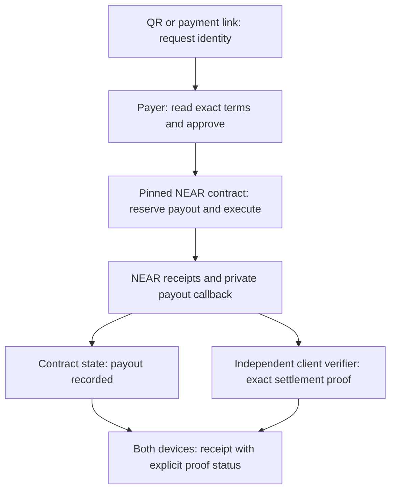

# System overview and trust boundaries

This is the current review map. [Release status](RELEASE_STATUS.md) identifies
which source belongs to Testnet, Mainnet and the deployed Preview. The older
[architecture](ARCHITECTURE.md) retains the original design history.

## One payment, several independent facts

The link is navigation, the wallet provides authorization, the contract enforces
payment rules, and the verifier checks evidence. None substitutes for another.

## Source map

Paths below are on `main` for Testnet unless a pinned Mainnet link is provided.

| Boundary | Responsibility | Source |
| --- | --- | --- |
| Browser wallet | Encrypted local key material, explicit transaction confirmation, restore | `apps/web/src/components/wallet/taply/`, `packages/near-client/src/wallet-vault.ts` |
| Testnet request/payout | Immutable request terms, exact deposit, asynchronous callback | `contracts/payments/src/lib.rs`, `docs/PAYMENT_STATE_MACHINE.md` |
| Protected payment | Separate escrow state machine, cutoff, refund/release | `contracts/payments-protected/`, `docs/TEST_PLAN.md` |
| Protocol | Shared schemas and canonical terms hashing | `packages/shared/` |
| Session/presence | Redis-backed coordination; not payment settlement | `apps/web/src/server/handshake/` |
| Testnet verifier | Receipt graph, pinned contract, amount/beneficiary checks | `apps/web/src/lib/verify/` |
| Mainnet contract | Separate network-specific native/USDC payment contract | [payments-mainnet](https://github.com/KendineCrypto/taply/tree/f88bc3fdd1d7b9cfabf95f73a3b48baf376968eb/contracts/payments-mainnet) |
| Mainnet settlement proof | Validate exact native/token receipt graph and deployment pins | [mainnet-settlement-receipts.ts](https://github.com/KendineCrypto/taply/blob/f88bc3fdd1d7b9cfabf95f73a3b48baf376968eb/packages/near-client/src/mainnet-settlement-receipts.ts) |
| Mainnet send lifecycle | Review, reserve before signing, handoff, reconciliation, replay tombstones | [mainnet-wallet-v2.ts](https://github.com/KendineCrypto/taply/blob/f88bc3fdd1d7b9cfabf95f73a3b48baf376968eb/packages/near-client/src/mainnet-wallet-v2.ts), [reconciliation](https://github.com/KendineCrypto/taply/blob/f88bc3fdd1d7b9cfabf95f73a3b48baf376968eb/packages/near-client/src/mainnet-reconciliation.ts) |
| Mainnet two-device receipt | Locate candidate funding, independently verify; ignore stale request results | [use-verified-receipt.ts](https://github.com/KendineCrypto/taply/blob/f88bc3fdd1d7b9cfabf95f73a3b48baf376968eb/apps/web/src/lib/mainnet/use-verified-receipt.ts) |

## Settlement vocabulary

| State/evidence | Meaning | Does not establish |
| --- | --- | --- |
| Wallet returned / transaction hash | A submission or lookup reference exists | Final execution or merchant receipt of funds |
| Matching FINAL execution | Exact recorded transaction executed with a final outcome | By itself, the entire business settlement |
| Contract `FINAL_PAID`, payout `SUCCEEDED` | Contract recorded a successful payout callback | Independent reconstruction of that claim |
| `VERIFIED_SETTLEMENT`, `PAID` | Verifier matched the expected receipt graph, beneficiary, amount, asset and pins | Light-client consensus verification, external audit, or unrelated payments |
| Unknown outcome | Evidence is insufficient | Failure, permission to resend, or a reason to delete the pending record |

Live Handshake provides presence and a comparison code. Its events never turn
an unresolved contract state into paid. The Mainnet release device ledger
coordinates browser tabs; it is not a global lock across all devices.

## Failure behavior worth reviewing

The tests exercise exact amounts, wrong accounts/terms, duplicate operations,
callback failure, lost wallet/RPC responses, replay and cross-device ownership.
A missing/mismatched proof keeps uncertainty visible. A retained hash can be
reconciled only through the existing FINAL verifier; no automatic resend occurs.

Native Mainnet automatic receipt discovery currently covers a first-attempt
payout. USDC and retry histories need their corresponding evidence; a native
proof is not reused to certify those paths. [Scope and tests](RELEASE_STATUS.md).
