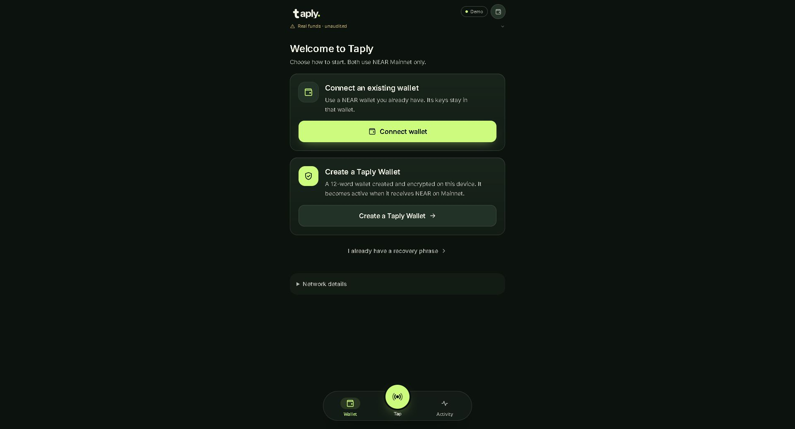

# Public Mainnet domain launch — 14 November 2026 UTC

The owner explicitly authorized publishing Mainnet at **taplyapp.xyz**. The domain
and its www redirect were moved in Vercel from project `taply` to `taply-mainnet`.

| Item | Observed result |
| --- | --- |
| Public URL | https://taplyapp.xyz → /m |
| www | https://www.taplyapp.xyz → apex domain |
| Domain configuration | Valid Configuration; branch staging/mainnet |
| Vercel environment | Preview, branch staging/mainnet; existing Ready artifact |
| Served source | fa4235f8122b5d0bdcafa9082d24f6fc30e5d578 |
| Deployment | 6DgFjUsspqv8SnFHLVjb3Z37FxBY |
| Anonymous access | HTTP 200, Mainnet build marker present, no Testnet marker or authentication wall |
| Original payment | Real 0.1 NEAR request opens on the new host; older UI displays Payment recorded |
| Spend/signing during launch | None; no wallet created/imported or transaction signed |

[Anonymous HTTP observations](http-checks.json) record exact timestamps and paths.
The browser also opened the real request
`a035569dc9662a19a7cd077606150e1f443673cef6823fe766ac4c73db852d16`
on the new host and saw the expected 0.1 NEAR payer/beneficiary. Its independent
[settlement proof](../mainnet-live-settlement-2026-11-14/README.md) is separate from
this deployment check.

## Why the served commit is older than the latest source

An explicit attempt to deploy f88bc3f was rejected by Vercel:
`Resource is limited - try again in 1 day (more than 100, code: api-deployments-free-per-day)`.
The existing Ready Mainnet deployment was connected to the custom domain through
the supported Preview branch assignment. There was no new build, plan purchase
or claim that f88bc3f was published. The newer receipt/recovery and compact Gift
changes remain pending; the live UI retains the earlier behavior.

This is a public Mainnet domain launch, not a new Vercel Production-environment
build. Future deployments of staging/mainnet can update this domain assignment;
its target must therefore be rechecked when reporting a later release.
