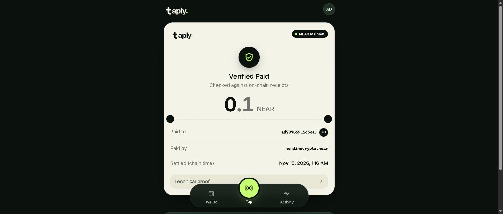

# Mainnet header cleanup and display-balance resilience

Owner requested removing the Demo/network pill and repeated real-funds/unaudited
header copy. Mainnet now opts out of the shared shell badge; Testnet keeps its
existing default. The always-visible safety disclosure is removed from Mainnet's
header. Synthetic fixture builds still visibly identify fixture data. Network
identity, exact transaction reviews, caps and signing gates are unchanged.

A live read-only diagnostic reproduced primary RPC timeouts while the approved
Mainnet archival provider read the same account successfully. The display-balance
hook now retries approved Mainnet providers on transient transport, rate-limit,
node-sync and unavailable-block errors. Each provider verifies Mainnet genesis
and reads the full native/USDC snapshot at one FINAL block. Wrong-network or
contradictory evidence is not retried into an apparently successful balance.
No snapshot fields are mixed; all providers failing remains an error, not zero.
The transaction planner/signer provider and checks are unchanged.

Focused tests cover fallback, refusal to mask mismatches and no fabricated zero.
TypeScript and lint pass. The new display reader also completed a live read-only
balance read. Browser QA checks the requested header absence and preserves the
fixture label assertion. CI and deployment must succeed before live completion
is claimed. No key, wallet signature or funds were used for these checks.

## Live verification

Source fa421573e6f95c9364da2bc696d91db4ae0b12b4 is live at taplyapp.xyz on
Vercel deployment C9dLkiTcJbdaDJEanzWjRfvojEYz (Ready; custom domain listed).
The automatic Git-triggered attempt reported a quota error; the subsequent
manual deployment of the exact tested commit succeeded. No plan was purchased.

The live header has zero network-pill and safety-line elements. A connected
account's native and USDC balances rendered successfully, without the previous
Balance unavailable notice. No wallet was unlocked by the agent and no financial
transaction was signed. The screenshot uses the already-public payment receipt,
rather than publishing a fresh wallet balance.

The actual 0.1 NEAR public request still reaches Verified Paid.
[PR #43](https://github.com/KendineCrypto/taply/pull/43) and
[workspace-check 43658449595](https://github.com/KendineCrypto/taply/actions/runs/43658449595):
web 1606 passed / 7 skipped; mobile, desktop and Turkish header checks passed;
release-browser 12/12; Phase 4 68/68, Phase 5 31/31, authority 6/6, Phase 6 18/18.
