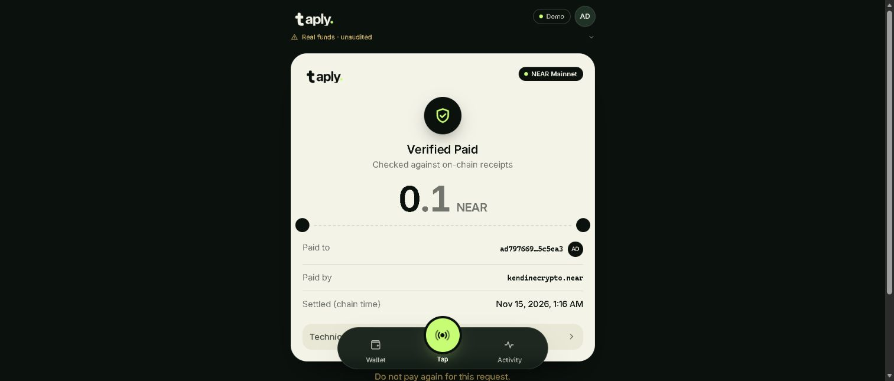

# Mainnet receipt/Gift and wallet reload fix — live verification

Observed **15 November 2026 UTC**, after the original 14 November domain launch.

| Fact | Evidence |
| --- | --- |
| Public host | https://taplyapp.xyz, anonymous HTTP 200, root redirects to /m |
| Served source | 7c0eac8b9b27cf0b6938010de6c9ca321c447e94 |
| Vercel deployment | CK8EfUJPnsS39FNeqivQeByXTigH, Ready, custom domain explicitly listed |
| Ready time | 2026-11-15 00:09:33 UTC |
| Environment | Preview, branch staging/mainnet, project taply-mainnet |
| Source CI | 673a4dc7aa896b9942822fc662ae7944f9df9551, three workflows passed |
| Live receipt | Real 0.1 NEAR request displayed Verified Paid / Checked against on-chain receipts |
| User wallet access / new spending | None during verification; public request read only |

The request is
`a035569dc9662a19a7cd077606150e1f443673cef6823fe766ac4c73db852d16`.
It shows kendinecrypto.near paying the expected implicit beneficiary. The earlier
[public proof](../mainnet-live-settlement-2026-11-14/README.md) independently
establishes the same exact native settlement. This screenshot is now an archived
observation, not a promise that later RPC availability never changes.

The current source includes PR #37/#38 receipt/Gift feedback and verification
changes plus PR #41 wallet reload persistence. The real Chromium release path
passed 12/12, including actual reload, nonextractable CryptoKey IndexedDB cloning,
fresh-tab lock and Lock now surviving reload. All tests use disposable unfunded
local vaults/synthetic RPC; no real user's wallet was unlocked for the live check.

[Workspace CI](https://github.com/KendineCrypto/taply/actions/runs/43656108715):
shared 93, near-client 350, web 1603 passed / 7 skipped, API 85; Phase 4 68/68,
Phase 5 31/31, authority 6/6, Phase 6 18/18. Wallet-browser and Mainnet-core CI
also passed. [PR #41](https://github.com/KendineCrypto/taply/pull/41).

Earlier deployment attempts were quota-blocked. This deployment subsequently
succeeded; the agent made no paid plan purchase and does not infer the quota
status of other projects. Source and deployment dates above are preserved.
